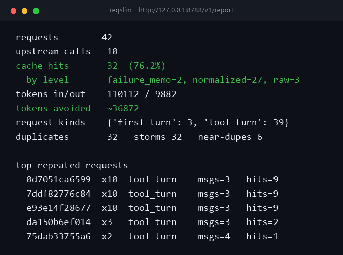

# reqslim

[](https://github.com/Fukaki-Ato/reqslim/actions/workflows/ci.yml)

[简体中文](README.md) | [English](README.en.md)

A request-reduction layer that sits in front of ZCode — **it never changes answers, only the number of requests**.

A coding agent burns dozens of turns and tool calls on a single task, and a large share of those requests are duplicates, predictable, or never needed the model at all. `reqslim` is a local proxy that intercepts them and keeps two separate ledgers — *how many times you logically asked* vs *how many times the upstream was physically hit* — so every saving is attributable to a specific mechanism.

Zero third-party Python dependencies at runtime; standard library only. The installer additionally needs `openssl` to create the local HTTPS certificate.

```
ZCode ──HTTPS──> 127.0.0.1:8788 (reqslim) ──HTTPS──> upstream API
                     ├─ hit:    answered locally, no request sent
                     └─ miss:   forwarded with JSON semantics preserved (Authorization / signing headers included)
```

ZCode 3.17 plan accounts enable client request signing, and the signer refuses
HTTP base URLs. The installer creates a loopback-only CA and certificate and
points `ZCODE_AGENT_CA_CERT` at the bundle so only ZCode trusts the listener.
`--no-tls` remains for older clients/debugging, but 3.17+ plan accounts then
fail with `ClientRequestSigningV4Error`.

---

## What it saves

| Waste | What it looks like | Treated by |
|---|---|---|
| **Exact duplicates** | Timeout retries, sub-agents asking the same thing concurrently | Raw byte hash, in-flight coalescing |
| **Same semantics, different bytes** | Cache breakpoints moving every turn, regenerated tool ids, reordered tool arrays | Request normalization |
| **Upstream failure amplification** | Identical retries right after a 429/5xx | Failure memo |

Four paths are tried in order; only if all miss is the request forwarded:

1. **Raw byte hash** — identical request bodies are settled by a single sha256, the cheapest possible check
2. **Normalized key**: removes cache-breakpoint and tool-order drift and consistently renames tool IDs while preserving their references
3. **In-flight coalescing** — the same request arriving while a previous one is still running waits for it instead of hitting the upstream again
4. **Failure memo** — when the upstream returns 429/5xx the request is remembered; identical retries within 20 seconds get the error replayed

---

## Three key decisions

**Normalization preserves references.** It ignores `cache_control` breakpoints and `tools` array order, and consistently renames `tool_use.id` and `tool_result.tool_use_id` instead of deleting their relationship. Swapping the ownership of parallel tool results produces a different cache key. Text, file contents, tool inputs, and thinking budgets stay in the key because they change the answer.

**Stream assembly preserves `thinking` + `signature` verbatim.** Lose the signature and the upstream rejects the session several turns later — the symptom is far from the cause, the hardest class of bug to trace. The assembler handles every block type Anthropic actually emits: `text`, `thinking`, `redacted_thinking`, `tool_use`.

**No context trimming.** Trimming an Anthropic conversation requires keeping `tool_use` / `tool_result` strictly paired; getting it wrong explodes turns later, and the cost is never worth it.

---

## Quick start

```bash
git clone https://github.com/Fukaki-Ato/reqslim.git
cd reqslim
python tools/install_zcode.py
```

Requires Python 3.9+ (standard library only, no pip install needed; CI covers 3.9 / 3.11 / 3.13 × Windows / Linux). The installer also needs `openssl` to create the local HTTPS certificate (bundled with Git for Windows; `--no-tls` skips it, but ZCode 3.17+ plan accounts then fail to sign). If the `python` command is missing, run `setup.bat` — it probes for an available interpreter. Use `git clone`; **do not use Download ZIP** (the `.bat` files inside are LF-normalized and some cmd.exe constructs misbehave on LF).

The installer locates the ZCode install, copies the provider table, points its `baseUrl`s at the local proxy, and sets up **logon autoload** (Windows) — **the proxy is already running when the installer finishes**, no reboot needed:

- the proxy is registered in the Startup folder and runs at logon via `pythonw` — no console window; logs at `%USERPROFILE%\.zcode\reqslim\proxy.log`;
- `ZCODE_BUILTIN_PROVIDER_CONFIG_FILE` is set as a user-level environment variable — ZCode then routes through the proxy no matter how it is started (taskbar, Start menu, other tools). **No launcher to click, ever**;
- the local HTTPS certificate and CA bundle are generated under `%USERPROFILE%\.zcode\reqslim\tls\`; `ZCODE_AGENT_CA_CERT` points at `ca-bundle.pem`, so only ZCode trusts the loopback listener;
- the installer also rewrites ZCode's **runtime provider caches** (`~/.zcode/v2/runtime/provider/...`) — since 3.16 these are what ZCode reads first, the env var is only the fallback (verified in the asar); each cache keeps a one-time `.bak-reqslim` backup;
- the proxy checks ZCode's bundled provider table and the runtime caches once a minute — **after a ZCode update, newly added providers are picked up within a minute**, no reinstall required.

The first install routes only the primary BigModel gateway. If your plan uses
another gateway such as `z.ai`, the installer lists it under `uncovered`; rerun
once with `--extra-upstream <URL>` to route it too.

### Verify the install

1. Check the proxy:

```bash
curl -sk https://127.0.0.1:8788/v1/health
```

Expect `"ok": true`, `"tls": true`, and the full `upstreams` map.

2. Open ZCode and send a minimal prompt (for example, "Reply with OK only").
3. Open `zcode-stats.bat` or `https://127.0.0.1:8788/v1/report`. `requests` should be greater than 0 and the `request reduction` block should be visible.
4. Create a new task and send the same prompt again; if it hits the cache, `reduced` and `by mechanism` should grow.

Daily use: just open ZCode. `start-zcode.bat` remains as a manual fallback (debugging on a different port, or if the Startup entry is removed; it checks every listener first and will not start a duplicate proxy). Uninstall:

```bash
python tools/install_zcode.py --uninstall   # stops the proxy, removes autostart + env var, restores caches; keeps requests.jsonl
```

`--no-autostart` only skips the logon entry and user env var; it **still rewrites the runtime caches**, so run `start-zcode.bat` before opening ZCode in that mode.

Full documentation — options, troubleshooting, rollback — in **[docs/ZCode接入指南.md](docs/ZCode接入指南.md)** (Chinese).
To set reqslim up on another machine's ZCode, there is a step-by-step runbook an AI agent can execute: **[docs/AI装配指南.md](docs/AI装配指南.md)** (Chinese).

The installer **never touches** the ZCode install directory, **never touches** ZCode user settings, and **never touches** credentials. It sets two user-level environment variables (`ZCODE_BUILTIN_PROVIDER_CONFIG_FILE`, `ZCODE_AGENT_CA_CERT`) and rewrites the provider/runtime cache tables (backups kept; `--uninstall` stops the proxy and restores them).

Existing user-level environment values are saved and restored on uninstall; values changed independently after installation are preserved. If a runtime cache cannot be restored, uninstall returns a nonzero status and keeps the recovery configuration and certificates. `--uninstall --dry-run` only previews changes and does not stop the proxy or modify files or environment variables.

Runtime caches keep `*.reqslim-state.json` ownership records alongside `.bak-reqslim` backups. These retain each provider's latest original upstream, so port changes and uninstall preserve later providers, metadata, and user proxy changes. Keep both recovery artifacts. Installation persists a recovery snapshot before changing user environment values and retains current configuration, certificates, and environment backups until restoration is confirmed.

### Multiple upstreams

API-key templates and plan accounts often live on **different gateways** (e.g. `open.bigmodel.cn` vs `zcode.z.ai`). Each gateway gets its own local port inside the same proxy process and report. Cache, coalescing, and the failure memo are partitioned by gateway, endpoint/query, credentials, and beta/version. Signing handshakes also use the current listener's gateway.

```bash
python tools/install_zcode.py \
  --extra-upstream https://zcode.z.ai/api/v1/zcode-plan/anthropic
```

The installer prints which upstreams in the table are still not proxied.

---

## Troubleshooting

| Symptom | Cause | Fix |
|---|---|---|
| `requests` stays 0 | provider not in the listener map, ZCode not restarted, or an old instance still running | Check `listen` / `uncovered`; quit ZCode from the tray and reopen; rerun the installer |
| Launcher says `cannot bind` | port in use or inside a Windows reserved range | rerun the installer with `--port 18888` |
| Installer cannot find `openssl` | no OpenSSL CLI | install Git for Windows; only older clients should consider `--no-tls` |
| ZCode logs `ClientRequestSigningV4Error` | listener is HTTP, or ZCode did not load the local CA | do not use `--no-tls`; rerun the installer and restart ZCode |
| ZCode logs `EPERM` / `Builtin 远端更新失败` | runtime cache is read-only so the cloud refresh cannot overwrite it | expected; rerun the installer or `--uninstall` to clear it |
| Browser warns about the certificate | loopback HTTPS uses a private CA | use `zcode-stats.bat`, add `-k` to curl, or trust the local CA in the browser |

---

## Reading the numbers

```bash
curl -k https://127.0.0.1:8788/v1/report       # live (-k: private loopback CA)
python -m reqslim.zcode --report <jsonl path>  # offline
```

```
request reduction
  estimated requests  8
  actual requests     3
  reduced             5  (62.5%)
  by mechanism        failure_memo=2, normalized=2, raw=1

requests        8
upstream calls  3
cache hits      5  (62.5%)
  by level       failure_memo=2, normalized=2, raw=1
tokens avoided  ~1320
duplicates      5   storms 5   near-dupes 2
```

`estimated requests` is every logical attempt ZCode made — what the upstream
would have received without the proxy. `actual requests` is what really
consumed an upstream call. The difference is the reduction, attributed to
`raw` / `normalized` / `coalesced` / `failure_memo`; `/v1/stats` exposes the
same object under `comparison`.

`near-dupes` are requests with the same final turn but different history — never cacheable, but a high count means your context is ballooning.



---

## Install (optional)

The launcher itself **does not require installing** — it sets `PYTHONPATH` to the module directory itself, independent of cwd and pip. Copy the folder to another machine, run the installer once, done.

If you want a console script:

```bash
pip install -e .        # provides the reqslim-zcode command
```

Requires **Python 3.9+** (declared in `requires-python`; CI covers 3.9 / 3.11 / 3.13 × Windows / Linux).

## Tests

```bash
python -m pytest
```

pytest not required — the test file ships a minimal runner:

```bash
python -I tests/test_zcode.py
python -I -m unittest discover -s tests -p "test_*regressions.py" -v
```

The script runner fails on unhandled background-thread exceptions. Network tests should use `proxy.close()` for teardown: `server_close()` alone does not stop `serve_forever` and can produce asynchronous socket errors on Windows.

Single-flight regressions combine disabled caching, immediate eviction, and oversized requests, including a frozen clock. Handoff eligibility uses publication generations observed when a request begins, not timestamp resolution, and never turns old handoffs into an implicit cache.

---

## Layout

```
reqslim/
├── types.py           response & usage value objects
├── cache.py           LRU response cache with TTL
└── zcode/             ZCode specifics (Anthropic Messages protocol)
    ├── normalize.py   request canonicalization (strips drift fields)
    ├── stream.py      stream assembly / replay (incl. thinking signatures)
    ├── analytics.py   traffic recording & reporting
    ├── comparison.py  estimated vs actual upstream requests
    ├── proxy.py       proxy core
    ├── tls.py         local HTTPS certificate and CA bundle
    └── __main__.py    CLI
tools/install_zcode.py installer (probe + rewrite provider tables/caches + register autostart)
tests/test_zcode.py    original integration tests
tests/test_*regressions.py  cache, protocol, and installation recovery tests
docs/                  ZCode integration guides (Chinese)
```

## Design constraints

Priority order; conflicts resolve in favor of the top:

1. **Unmountable** — removing the proxy changes the request count and nothing else. No response rewriting, no model swapping, no request mutation.
2. **Framework-agnostic** — the core has zero dependencies; the proxy speaks the Anthropic Messages protocol and recognizes no client framework.
3. **Auditable** — logical requests and physical requests are ledgered separately, and every saving is attributed to the mechanism that produced it. Without that split you cannot tell a cache that never hits from one that always hits, and a failure-retry storm looks like ordinary traffic.

## What it does not do

- **No model swapping** (no routing down to cheaper models)
- **No context trimming** (see above)
- **No response rewriting**
- **No semantic guessing** — exact matching only, no embedding cache. Silently guessing is worse than not caching.

## Privacy and security

- Listens on `127.0.0.1` only, so the LAN cannot reach it.
- `Authorization` and other credentials are forwarded with the request and never written to disk.
- `requests.jsonl` records hashes, status, latency, token counts, tool names, and hit attribution — never prompt or response bodies.
- The private CA key lives under `%USERPROFILE%\.zcode\reqslim\tls\`; a successful uninstall removes the certificate directory and restores the previous CA environment setting.

## Known limitations

- **Near-duplicates are not cached** — same question, longer history: the content genuinely differs, so it must not hit. These are counted in `near-dupes`.
- **Streaming errors are not cached and not memoized** — when the upstream reports `200 + event: error` (overloads do this), the response is not cached and the retry genuinely hits the upstream. If the upstream dies mid-stream, reqslim sends an explicit SSE `error` event so a partial answer cannot look complete.
- **Request bodies over 1 MB are not cached** — memory protection; a concurrent duplicate is still shared by the in-flight handoff, but later independent requests hit the upstream again.
- **Cache hits are not streamed verbatim** — the full SSE is returned at once, faster, but without the typewriter effect.
- **Only the Anthropic Messages endpoints and the signing handshake are proxied** — `/v1/messages`, `/v1/messages/count_tokens`, and ZCode's `/api/paas/...` signing handshake; other paths return 404 and close the connection so an unread body cannot poison keep-alive.
- **Single process, single instance** — a second instance on the same port fails loudly. Windows' default `SO_REUSEADDR` would let it silently steal traffic, so it is deliberately disabled.
- **Upgrades/port changes restart the proxy** — the installer and `--autostart` stop the old instance before rebasing runtime caches; a 0.2.2 instance has no `/v1/shutdown`, so stop it manually or reboot once.
- **Runtime caches are read-only** — this stops ZCode's cloud refresher from overwriting the local table at startup; `EPERM` / "Builtin 远端更新失败，继续使用本地配置" in ZCode logs is expected. Re-run the installer or `--uninstall` to handle the flag.
- **The loopback HTTPS listener uses a private CA**: its certificate covers only `127.0.0.1` / `localhost` and is exposed to ZCode through `ZCODE_AGENT_CA_CERT`; browsers or curl checking the report page need `-k`. A successful uninstall removes the certificate directory and restores the previous CA environment setting.
- **macOS / Linux paths are untested on real hardware** — the development machine is Windows.

## License

MIT. See [LICENSE](LICENSE).
