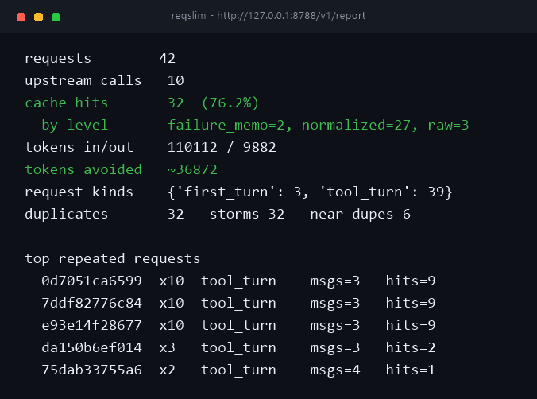

# reqslim

[](https://github.com/Fukaki-Ato/reqslim/actions/workflows/ci.yml)

[简体中文](README.md) | [English](README.en.md)

挂在 ZCode 前面的请求削减层 —— **不改回答，只减请求**。

编码 Agent 一个任务几十轮、几十次工具调用，其中大量请求是重复的、可预测的，或者根本不需要问模型。`reqslim` 是一个本地代理，把这些请求拦下来，把「逻辑上问了几次」和「物理上打了几次上游」分开记账，每一笔节省都能归因到具体机制。

零第三方依赖，纯标准库。

```
ZCode ──HTTP──> 127.0.0.1:8788（reqslim） ──HTTPS──> 上游 API
                    ├─ 命中：直接返回，不发出请求
                    └─ 未命中：原样转发（含 Authorization 头）
```

---

## 它省的是什么

| 浪费 | 长什么样 | 谁来治 |
|---|---|---|
| **完全重复** | 超时重试、子 agent 并发问同一句 | 原始字节哈希、单飞合并 |
| **语义相同、字节不同** | 缓存断点每轮挪位置、tool id 重新生成、工具数组换顺序 | 请求规范化 |
| **上游故障放大** | 429/5xx 之后紧跟的相同重试 | 失败记忆 |

四条路径按顺序试，全部未命中才转发：

1. **原始字节哈希** —— 一模一样的请求体，一个 sha256 就能判定，成本最低
2. **规范化键** —— 剥掉每轮都变但语义不变的三样东西（见下）
3. **单飞合并** —— 同一请求上一个还没结束时又来一次，后到的等前一个，不重复打上游
4. **失败记忆** —— 上游 429/5xx 时按请求记下，20 秒内相同重试直接回放该错误

---

## 三个关键点

**规范化只剥离三样。** `cache_control` 断点、`tool_use.id`、`tools` 数组顺序 —— 这三样每轮都变但语义不变，不剥离的话命中率接近零。除此之外全部保留在缓存键里：文本、文件内容、工具入参、thinking 预算，因为它们确实会改变回答。

**流装配逐字保留 `thinking` + `signature`。** 丢了签名上游会在几轮之后才拒绝会话，症状离病因很远，是最难查的那类 bug。装配器处理 Anthropic 实际会发的每种块：`text`、`thinking`、`redacted_thinking`、`tool_use`。

**不做上下文裁剪。** 裁剪 Anthropic 对话要保持 `tool_use` / `tool_result` 严格配对，改错会在几轮之后才炸，代价太大。

---

## 快速开始

```bash
git clone https://github.com/Fukaki-Ato/reqslim.git
cd reqslim
python tools/install_zcode.py
```

需要 Python 3.9+（仅标准库，无需 pip install；CI 覆盖 3.9 / 3.11 / 3.13 × Windows / Linux）。没有 `python` 命令时双击 `setup.bat`，它会自动探测可用的解释器。请用 `git clone` 获取代码，**不要用 Download ZIP**（zip 内 `.bat` 是 LF 换行，个别 cmd 场景会出错）。

安装器会探测 ZCode 安装位置、复制 provider 表并把 `baseUrl` 指向本地代理，然后配置**开机自动装载**（Windows）——**装完代理就已启动**，不用重启：

- 代理注册到启动文件夹，登录即运行，`pythonw` 无窗口，日志在 `%USERPROFILE%\.zcode\reqslim\proxy.log`；
- `ZCODE_BUILTIN_PROVIDER_CONFIG_FILE` 设为用户级环境变量 —— 之后 ZCode 无论从任务栏、开始菜单还是别的工具启动，都自动走代理，**不需要再点任何 bat**；
- 代理每分钟检查一次 ZCode 自带的 provider 表，**ZCode 更新后新 provider 会在一分钟内自动接入**，无需重装本工具。

日常使用：直接打开 ZCode 即可。`start-zcode.bat` 保留为手动兜底（换端口临时调试时用）。卸载：

```bash
python tools/install_zcode.py --uninstall   # 移除自启项与环境变量，保留 requests.jsonl
```

完整说明、参数、排查表、回滚步骤见 **[docs/ZCode接入指南.md](docs/ZCode接入指南.md)**。
要在另一台设备的 ZCode 上装配（AI agent 可直接执行的分步 runbook）见 **[docs/AI装配指南.md](docs/AI装配指南.md)**。

安装器**不改** ZCode 安装目录、**不改**用户配置、**不碰**登录凭据，随时能摘掉。

### 多上游

API key 模板和套餐账号常落在**不同网关**（如 `open.bigmodel.cn` 与 `zcode.z.ai`）。每个网关分一个本地端口，同一代理进程、同一份报告；缓存、单飞、失败记忆按上游分区 —— 拿 A 网关的缓存回放给 B 网关的请求，就违背了「摘掉后行为不变」的承诺。

```bash
python tools/install_zcode.py \
  --extra-upstream https://zcode.z.ai/api/v1/zcode-plan/anthropic
```

安装器会提示表里还有哪些上游没接进来。

---

## 看数据

```bash
curl http://127.0.0.1:8788/v1/report          # 实时
python -m reqslim.zcode --report <jsonl 路径>  # 离线
```

```
requests        8
upstream calls  3
cache hits      5  (62.5%)
  by level       failure_memo=2, normalized=2, raw=1
tokens avoided  ~1320
duplicates      5   storms 5   near-dupes 2
```

`near-dupes` 是最后一轮相同但历史不同的请求 —— 缓存不了，但数字高说明上下文在膨胀。



---

## 安装（可选）

启动器本身**不依赖安装** —— 它自己设 `PYTHONPATH` 指向模块目录，跟 cwd 和 pip 都无关。整个文件夹拷到别的机器，跑一次安装器就能用。

需要 console script 时：

```bash
pip install -e .        # 提供 reqslim-zcode 命令
```

需要 **Python 3.9+**（`requires-python` 里声明；CI 覆盖 3.9 / 3.11 / 3.13 × Windows / Linux）。

## 测试

```bash
python -m pytest        # 44 个用例
```

不装 pytest 也能跑，测试文件自带最小 runner：

```bash
python tests/test_zcode.py
```

---

## 目录

```
reqslim/
├── types.py           响应与用量值对象
├── cache.py           带 TTL 的 LRU 响应缓存
└── zcode/             ZCode 特化（Anthropic Messages 协议）
    ├── normalize.py   请求规范化（剥离漂移字段）
    ├── stream.py      流装配 / 重放（含 thinking 签名）
    ├── analytics.py   流量记录与统计
    ├── proxy.py       代理主逻辑
    └── __main__.py    CLI
tools/install_zcode.py 安装器（探测 + 改写 provider 表 + 注册自启）
tests/test_zcode.py    44 个用例
docs/                  ZCode 接入指南
```

## 设计约束

按优先级排，冲突时上面的赢：

1. **可摘除** —— 摘掉代理只改变请求数，不改变答案。不重写响应、不换模型、不动请求体。
2. **不绑框架** —— 核心零依赖，代理只认 Anthropic Messages 协议，不认任何客户端框架。
3. **可审计** —— 逻辑请求与物理请求分开记账，每一笔节省归因到造成它的机制。没有这个拆分，你既分不清「缓存从不命中」和「缓存一直命中」，也会把一次失败重试风暴看成正常流量。

## 它不做什么

- **不换模型**（不做路由降级到便宜模型）
- **不裁剪上下文**（理由见上）
- **不重写响应**
- **不猜语义** —— 只做精确匹配，没有 embedding 缓存。默默猜一个比不缓存更糟。

## 已知限制

- **近似重复缓存不了** —— 同一个问题但历史更长，内容确实不同，不该命中。这类会计入 `near-dupes`。
- **流式错误不缓存，也不进失败记忆** —— 上游用 `200 + event: error` 报错时（过载就是这样），这次响应不会被缓存，重试会真实打到上游。宁可多打一次，也不回放一个假的空回答。
- **超过 1 MB 的请求体不缓存** —— 保护内存，长上下文会话最后几轮通常属于这类。
- **缓存命中时不是逐字流式** —— 一次性返回完整 SSE，更快，但没有打字机效果。
- **代理只处理 `anthropic-messages` 协议** —— OpenAI 兼容的 provider 模板不在改写范围。
- **单进程单实例** —— 同一端口开第二个会直接报错退出。Windows 默认的 `SO_REUSEADDR` 会让它静默抢流量，所以特意关掉了。
- **macOS / Linux 路径未经实机验证** —— 开发机是 Windows。
